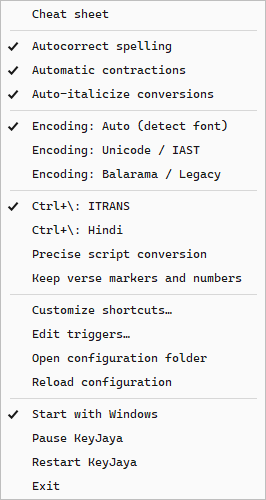

# KeyJaya user guide

KeyJaya adds diacritics, expands abbreviations, and converts scripts in editable
text. This guide covers the default keys and the settings available from its
Windows tray icon. If you customize a shortcut, use your chosen key instead.

- [Installation](#installation)
- [Letters, words, and selections](#letters-words-and-selections)
- [All eight default shortcuts](#all-eight-default-shortcuts)
- [Fonts and encoding](#fonts-and-encoding)
- [Script conversion](#script-conversion)
- [Abbreviations and scripture](#abbreviations-and-scripture)
- [Automatic corrections and italics](#automatic-corrections-and-italics)
- [Tray settings and shortcut customization](#tray-settings-and-shortcut-customization)
- [Using KeyJaya in different editors](#using-keyjaya-in-different-editors)
- [Troubleshooting](#troubleshooting)

## Installation

1. Open the [latest release](https://github.com/matsya-dev/KeyJaya/releases/latest)
   and download the **KeyJaya Setup** `.exe` under **Assets**.
2. Run setup. You can choose whether to create a desktop shortcut.
3. Find the white **की** icon in the Windows system tray, possibly under the
   hidden-icons arrow. Open **Cheat sheet** from its menu, or choose **Open Cheat
   sheet** when setup finishes.

KeyJaya requires **Windows x64 and .NET Framework 4.8**. The installer includes
its dictionaries. You do not need Python, Git, or developer tools to use it.
Balarama fonts are supplied separately.

The current installer is unsigned, so Windows may display an unrecognized-app
warning. Download from the repository's Releases page and compare the file's
SHA-256 with the release's **SHA256SUMS.txt**. Keep Windows security protection
enabled.

KeyJaya starts after installation and when you sign in to Windows. Turn off
**Start with Windows** in the tray menu if you prefer to launch it yourself.
To open it later, search for **KeyJaya** in the Start menu, use its desktop
shortcut, or use Flow Launcher with Start Menu indexing enabled. Updates preserve
your settings, custom triggers, and desktop-shortcut choice.

For a short guided trial, follow the [five-minute check](FIRST_RUN_CHECK.md) in a
new scratch document.

## Letters, words, and selections

### Change one letter

Type a letter and press **backtick** (the `` ` `` key). It changes only the letter
immediately before the caret. Repeated presses cycle its options:

- `a` → `ā` → `a`
- `s` → `ṣ` → `ś` → `s`

You can move the caret back to an existing letter before pressing backtick. For
example, in `ki jaya!`, put the caret immediately after the `i` to make `kī jaya!`.
In a Balarama font, Auto encoding produces the corresponding legacy characters.
After an unsupported character, such as a space, backtick types normally.

### Convert a word

Type `Krishna` and **tap Left Ctrl by itself** to get `Kṛṣṇa`. Ordinary shortcuts
such as Ctrl+C and Ctrl+V continue to work.

With **Auto-italicize conversions** enabled, the first Ctrl tap italicizes an
already-correct Sanskrit/Bengali spelling without changing it: `bhakti` → *bhakti*,
`nitya` → *nitya*, and `dvijas` → *dvijas*. Later taps cycle alternative spellings
and eventually restore the original spelling and formatting. If there are no
alternatives, Ctrl cycles between italic and the original formatting.
Pausing between Ctrl taps keeps the active cycle's original formatting; typing
or navigating to another editing location starts a new cycle.

Individual word conversions can also italicize loanwords such as `dharma`, `guru`,
`yoga` and `karma`, including their plurals. Exactly one selected word counts as
an individual conversion. Proper names retain regular type, and ordinary English
protection remains. Formatting requires an editor surface that supports it;
Word comments and replies keep their current formatting.

These shortcuts also work while writing or replying to Word comments, in the
Comments panel and contextual bubbles as well as the classic editor. Place the
typing caret inside the comment or reply before converting. Modern comment edits
keep the comment's current formatting.

The caret can be inside an existing word, directly after it, or after attached
punctuation. A trailing space separates it from that word. Repeated taps cycle
available spellings and the original plain spelling continuously. For example:

`Rama` → `Rāma` → `Ramā` → `Rāmā` → `Rama` → `Rāma`

Known incomplete spellings are filtered out of cycles when dictionary and
grammatical references confirm the alternatives. Valid spellings and the original
plain form remain available; uncovered Bengali/book forms are retained.

Configured short abbreviations take priority over ordinary word conversion.
Recognized plurals are supported too, such as `acaryas` → `ācāryas`.

### Compounds and separators

At the end of `Vyasa-puja`, Left Ctrl converts the whole compound to `Vyāsa-pūjā`.
Inside the compound, it targets the current component. Immediately before a dash
it targets the left component; immediately after it, the right component.
After punctuation following a compound, it targets the final component.
Hyphens, nonbreaking hyphens, and en dashes are preserved.

A forward slash separates targets: `God/Krsna` with the caret at the end becomes
`God/Kṛṣṇa`. Unknown or English components stay unchanged during ordinary
word conversion.

### Convert a selection

Select one or more words and tap Left Ctrl. KeyJaya converts recognized
Sanskrit/Bengali words while leaving ordinary English and passage numbers
unchanged. With automatic italics enabled, it also styles eligible words that
already have diacritics.

For example, `Earlier untouched raja and Krsna.` becomes
`Earlier untouched rāja and Kṛṣṇa.` Only the eligible Sanskrit term gains italics;
English and the proper name keep regular type. Convert a passage once, then target
individual words to cycle their spellings.

Converted selections remain selected. If you immediately continue typing while a
conversion is finishing, queued typing follows the converted passage at its end.

For selections containing several words, regular-type loanword exceptions such
as `dharma`, `guru`, `yoga` and `karma` (and their plurals) are made regular even
if they were already italic. Other eligible Sanskrit/Bengali terms become italic,
including words whose spelling needs no diacritics. Complete Sanskrit compounds
such as *bhakti-yoga*, *nitya-dharma* and *guru-sevā* are treated as single terms.

### Spell out a number

Place the caret inside or immediately after a single number, or select only that
number, and tap Left Ctrl:

- `24` → `twenty-four`
- `24th` → `twenty-fourth`

Numbers inside a longer selected passage remain numbers. There is no `#` trigger.

### Undo

Press **Backspace immediately after a manual letter or word conversion** to
restore the original text. After several cycles, it restores the text from before
cycling, including its formatting. A component conversion restores that component.

Use **Ctrl+Z** to undo a selected-text conversion. Automatic spelling and
contraction corrections retain normal Backspace behavior.

## All eight default shortcuts

| Action | Default key | Example output |
| --- | --- | --- |
| Single letter | Backtick | `a` → `ā` |
| Word, selection, abbreviation, verse reference, or single number | Left Ctrl tap | `Krishna` → `Kṛṣṇa`; `BG18.66` inserts a verse |
| Unicode / IAST | `Ctrl+.` | `kṛṣṇa` |
| Balarama / legacy | `Ctrl+,` | `kåñëa` |
| Plain Roman text | `Ctrl+/` | `krsna` |
| ITRANS or Hindi Devanagari | `Ctrl+\` | `kRShNa` or `कृष्ण` |
| Sanskrit Devanagari | `Ctrl+[` | `कृष्ण` |
| Bengali script | `Ctrl+]` | `কৃষ্ণ` |

For the six output shortcuts, **select text first**; copying is optional. With no
selection, KeyJaya uses your copied text. `Ctrl+/` removes diacritics to produce
plain Roman spelling; it is not a general paste-without-formatting command.

These commands preserve the original clipboard when it can be safely backed up
and restored. A conversion may be skipped if that cannot be verified. See
[Privacy and local data](PRIVACY.md) for the clipboard behavior in detail.

Conversion shortcuts take priority over matching app commands while KeyJaya is
active. For example, Ctrl+[ and Ctrl+] produce scripts instead of Word's font-size
commands. Change the bindings through **Customize shortcuts**, or pause KeyJaya
to restore the app's normal key behavior.

## Fonts and encoding

The tray offers three choices for letter/word conversion and automatic short
abbreviations:

- **Encoding: Auto (detect font)** follows the target font where the editor
  exposes it. Use this for a mixture of Unicode and Balarama documents.
- **Encoding: Unicode / IAST** forces Unicode output.
- **Encoding: Balarama / Legacy** forces legacy output.

An explicit choice wins over font detection. The six output shortcuts explicitly
choose their own output; Ctrl+. produces Unicode and Ctrl+, produces Balarama.

Legacy text needs a matching Balarama font to display correctly. For example,
`kåñëa` is the stored legacy spelling of `kṛṣṇa`. In a regular Unicode font, those
legacy characters look different.

In Word, Auto can repair a Balarama word containing Unicode characters that have
fallen back to another font. It converts the word to legacy encoding and uses the
surrounding Balarama font. In InDesign Find/Change fields, Auto uses Unicode
because the field's display font does not identify the document's encoding.

## Script conversion

### Choose the output

- **Ctrl+[** produces Sanskrit Devanagari.
- **Ctrl+]** produces Bengali script.
- **Ctrl+\** produces ITRANS by default. Select **Ctrl+\: Hindi** in the tray to
  produce Hindi Devanagari instead. Only one Ctrl+\ output is selected at a time;
  the Sanskrit and Bengali shortcuts remain available.

Select `kṛṣṇa` and try each output: `कृष्ण`, `কৃষ্ণ`, or `kRShNa`.
For everyday Hindi, choose Hindi and convert `aapka phool phul sa hi na` to
`आपका फूल फूल स हि न`.

Script shortcuts accept valid Roman syllables even when they overlap English:
`hi` can become `हि` or `হি`, and `na` can become `न` or `ন`. Select only the text
you intend to transliterate. Ordinary word conversion still protects English.

### Convert back to Roman text

**Ctrl+.** detects Devanagari, Bengali, Balarama, and recognized ITRANS input and
produces Unicode / IAST. Mixed-script passages are supported.

Devanagari readings use word and sentence context to distinguish Hindi from
Sanskrit. Ambiguous text defaults to the Sanskrit reading: isolated `राम` becomes
`rāma`, while clear Hindi context can use `rām`. Sanskrit endings are retained in
forms such as `श्रीकृष्णाय` → `śrīkṛṣṇāya`.

### Common spellings or precise conversion

With **Precise script conversion** off, KeyJaya uses recognized words, common
Roman spelling variants, and known phrases to choose script spellings. Plain
Roman input is ambiguous, so review the result.

Enable **Precise script conversion** to follow the supplied sounds without those
spelling guesses. For example, ordinary conversion interprets `kala` as `काल`,
while precise conversion gives `कल`. Precise script-to-Roman conversion also
keeps the written vowels instead of applying Hindi pronunciation adjustments.

### Numbers and verse markers

Devanagari output uses Devanagari digits (`123` → `१२३`), and Bengali output uses
Bengali digits (`123` → `১২৩`). Conversion to Roman text uses standard Arabic
numerals for ordinary numbers.

By default, conversion from Indic scripts to Roman text removes verse bars/danda
marks and their adjacent verse numbers. Other numbers remain. A colon used as
visarga after Indic text is recognized: `प्रजा: ॥ ६ ॥` becomes `prajāḥ`.
Enable **Keep verse markers and numbers** to retain the verse structure.

## Abbreviations and scripture

### Short abbreviations

Type an abbreviation and tap Left Ctrl to expand it in the selected encoding:

| Abbreviation | Unicode expansion |
| --- | --- |
| `SP` | `Śrīla Prabhupāda` |
| `HT` | `Haridāsa Ṭhākura` |
| `SPG` | `Supreme Personality of Godhead` |
| `ISKCON` | `International Society for Krishna Consciousness` |

Abbreviations are case-sensitive: `SP` and `sp` are different. Their configured
replacement capitalization is preserved. Fixed wording can remain unchanged in
all encodings.

Explicit endings also work while typing:

- `SP>` or `krsna>` gives Unicode.
- `SP<` or `krsna<` gives Balarama.
- `SP?` or `krsna?` gives plain Roman spelling.

Open the cheat sheet's **Triggers** tab to search the available entries.

### Add, edit, or delete an abbreviation

1. Choose **Edit triggers…** from the tray or the bottom of the cheat sheet.
2. Search for an existing abbreviation, or add a new one.
3. Enter a Unicode replacement or paste Balarama text. The editor generates the
   Unicode, Balarama, and plain forms, with optional output overrides.
4. Use **Keep replacement exactly as entered** for fixed wording. Uncheck an
   entry to disable it temporarily. **Restore built-in** resets only the selected
   built-in abbreviation.
5. Click **Save and apply** to activate the changes across apps. **Cancel**
   discards unsaved edits.

An abbreviation works with Left Ctrl and its explicit >, <, and ? forms. Deleting
it removes all forms together. A backup of the previous trigger file is kept
automatically; updates preserve your custom triggers.

### Insert a verse or translation

Type a reference and tap **Left Ctrl** to insert it using the selected encoding.
You can also place the caret inside an existing reference or select just the
reference before tapping Ctrl. For Bhagavad-gītā 18.66:

| Reference + Left Ctrl | Inserts |
| --- | --- |
| `BG18.66` | Verse |
| `BG18.66T` | Translation |
| `BG18.66VT` | Verse and translation |
| `BG18.66VTR` | Verse, translation, and reference |

With no `V`, `T`, or `R` modifier, a reference always inserts **verse only**.
`R` by itself adds the reference to the verse; `TR` adds it to the translation.

Ctrl uses **Encoding: Auto (detect font)** or your explicit encoding override.
The complete reference is replaced; surrounding text and punctuation are kept.
Typing a reference alone leaves it unchanged until you activate it.

The symbol endings remain available: `BG18.66>` inserts Unicode, `BG18.66<`
inserts Balarama, and `BG18.66?` inserts plain Roman text. The cheat sheet lists
the supported scripture formats. Insertions use the document's formatting;
automatic italics follow the rules below.

### Insert a verse range

Use a hyphen or en dash between verse numbers, without spaces:

- `BG2.13–14` + Left Ctrl inserts both verses.
- `BG2.13–14VT` + Left Ctrl inserts verse 13 with its translation, then verse 14
  with its translation.
- `BG2.13–14VTR` adds one reference for the complete range at the end.
- `SB1.2.6-7>` inserts verses 6–7 in Unicode; `<` and `?` choose the other
  encodings as usual.

A full endpoint such as `BG2.13-2.14` also works. Ranges must stay within one
chapter and contain no more than 200 verses. If a required verse or translation
is missing, the complete reference stays unchanged. When consecutive verses share
one translation in the source, those verses are grouped and the translation is
inserted once. Each verse receives verse italics; translations retain prose styling.

## Automatic corrections and italics

**Autocorrect spelling** and **Automatic contractions** are separate tray options.
For example, typing `teh ` corrects it to `the `, and `doesnt ` becomes `doesn’t `.
Contractions use curly apostrophes and also recognize supported punctuation or
Enter as a word ending. `lets` / `Lets` become `let’s` / `Let’s`.

**Auto-italicize conversions** is enabled by default. It styles eligible
Sanskrit/Bengali terms throughout a converted selection, including words that
already have diacritics. Names, places, festivals and editorial exceptions follow
the app's BBT/BVT style rules. Passage conversions keep English loanwords such as
`guru` and `yoga` regular; individual word conversions can italicize them. Name
context can distinguish a personal name from an ordinary term. This setting
controls both individual-word italics and passage formatting; turning it off
disables both.

Complete inserted Sanskrit/Bengali verses are italicized. In translations, only
eligible terms gain italics; proper names and English remain regular.
Devanagari, Bengali script, and ITRANS outputs never gain automatic italics.

Supported rich-text editors use native formatting. Plain-text fields stay plain.
Supported Markdown editing uses italic markers and protects code and links.
Turn the option off to convert without adding automatic italics.

## Tray settings and shortcut customization

Advanced preferences are grouped in `config/customizations.ini`: word aliases,
preferred or protected spellings, script words/phrases, italics exceptions, and
ordered replacements. Its commented examples explain each section. Save changes
and choose **Reload configuration**. Existing legacy TSV customizations still
work without modification; entries in the new file override legacy entries of
the same kind. Word preferences take priority over general aliases.

Open the menu from the white **की** icon:

The menu and its windows follow Windows light, dark, and high-contrast settings
and monitor scaling. The screenshot shows the default light-theme appearance.

- **Cheat sheet** is a quick, searchable reminder of shortcuts and triggers.
- **Customize shortcuts…** changes all eight actions. Letter and word actions
  can also use function keys or supported shortcut chords. Save to apply changes,
  or restore defaults. The same window is available from the cheat sheet.
  **Check Word conflicts…** in this window compares current Word assignments with
  proposed KeyJaya bindings before you save. It also checks six Left/Right
  navigation chords, including Ctrl+Shift+Left. Word must already be open. The
  check covers the active window in each accessible Word instance and changes no
  assignments, templates or documents. An overlap means KeyJaya takes priority
  while enabled; a different navigation assignment may be intentional.
- **Start with Windows** controls automatic launch at sign-in.
- **Pause KeyJaya** temporarily restores ordinary app key behavior; choose
  **Resume KeyJaya** to reactivate it.
- **Restart KeyJaya** restarts the app. **Exit** closes it.
- **Open configuration folder** and **Reload configuration** are available for
  advanced configuration. Use the built-in trigger and shortcut editors for
  routine changes.

## Using KeyJaya in different editors

These editing areas have been exercised during development:

| App | Editing areas and notes |
| --- | --- |
| Microsoft Word | Body text, footnotes/endnotes, Comments panel and contextual comment/reply bubbles, Unicode/Balarama fonts, Track Changes, pasted text and Paste Options |
| Adobe InDesign | Text frames, footnotes/endnotes, Text/GREP Find/Change fields; GREP codes are preserved |
| Zen/browser editors, ChatGPT, WhatsApp | Editable plain-text and rich-text fields |
| Obsidian | Writable Markdown, including Live Preview |
| Microsoft Excel | Cells in edit mode with a visible text caret, including word/letter conversion and selected passages across lines; keep **View → Formula Bar** enabled |
| Adobe Acrobat | Sticky-note comments, replies, and text-box comments |

In Excel, selected passages can span line breaks and remain selected after
conversion. Emoji and combining accents elsewhere in a cell no longer block a
nearby word conversion when navigation can avoid them. Selections or navigation
through character clusters whose cursor behavior is unverified can still be
skipped. Formula-like buffers and cells longer than 4,096 characters remain
excluded.

Word comments inherit the comment field's current formatting; KeyJaya does not
add automatic italics there.

App versions and controls can behave differently; custom, protected, or elevated
editors may not support conversion. Physical installation on a separate user's
computer still awaits validation. Hosted automated tests check logic, builds,
and isolated installation, rather than these editor interactions.

## Troubleshooting

| What happens | What to check |
| --- | --- |
| A conversion does nothing | Check the tray icon, confirm KeyJaya is unpaused, and put the caret in editable text. |
| The previous word does not convert | Move the caret inside or directly after it or its punctuation; remove any trailing space from the target position. |
| Characters look wrong | Check the encoding choice and font. Legacy output needs a Balarama font. |
| A shortcut runs an app command | Check Customize shortcuts for a conflict or a changed binding. Pause restores ordinary app commands. |
| A short abbreviation does not expand | Check exact capitalization and confirm the entry is enabled in Edit triggers. |
| Italics are absent | Check Auto-italicize conversions, the term's style exception, and whether the field supports formatting. |
| Roman input produces an unexpected script spelling | Try precise conversion or a more explicit phonetic spelling; ambiguous input can have multiple readings. |

If the problem persists, [report a bug](https://github.com/matsya-dev/KeyJaya/issues/new?template=bug-report.yml)
with the KeyJaya/app versions, font, encoding choice, exact scratch input, keys,
caret/selection position, and whether the text was typed or pasted. Test with
nonprivate scratch text; do not attach working documents or private content.

Read [Privacy and local data](PRIVACY.md) for keyboard monitoring, clipboard
handling, preferences, and logs. Report vulnerabilities through the
[private security process](../SECURITY.md).
